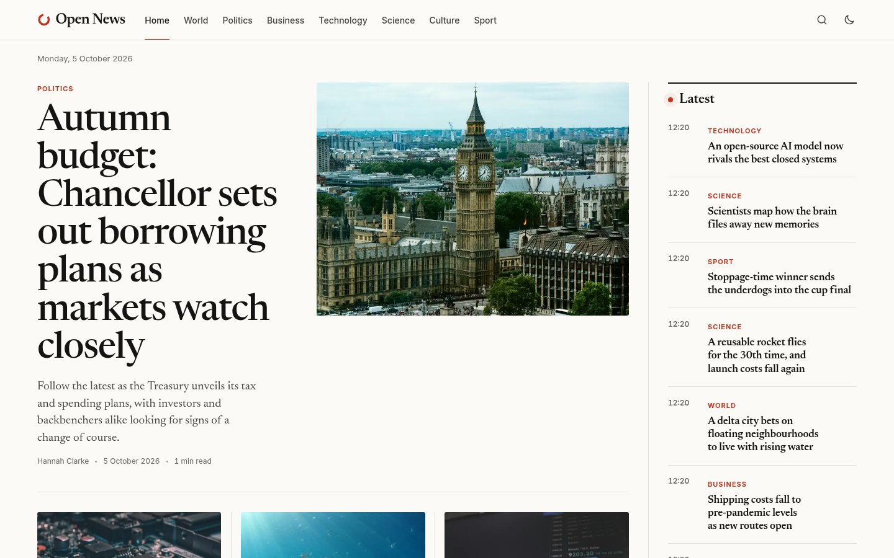
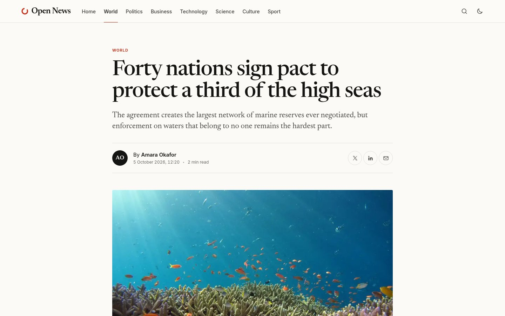
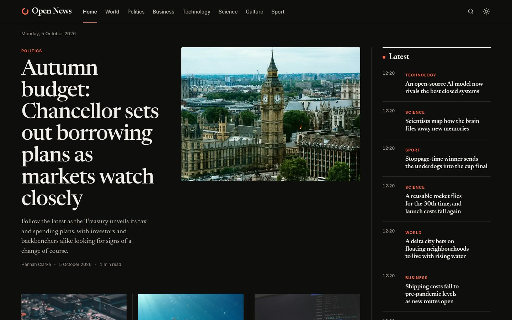
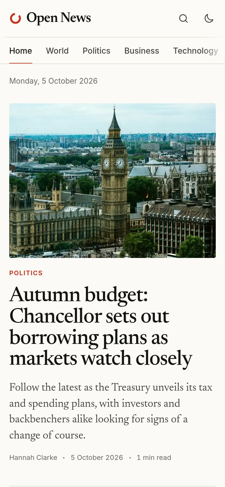
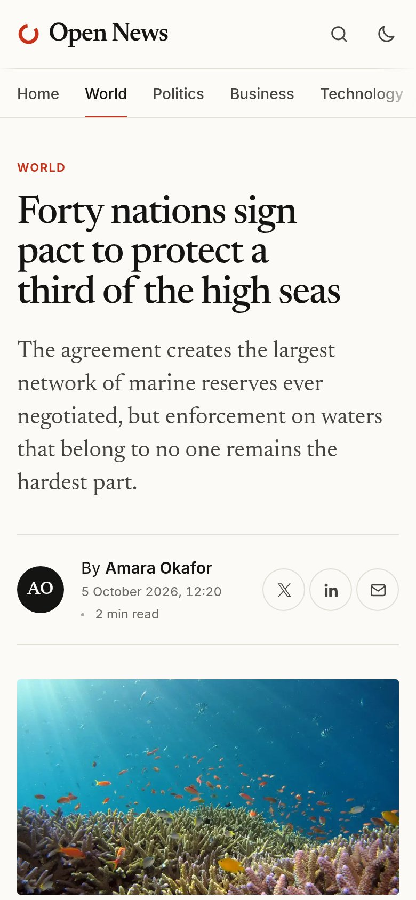

# Open News frontend

A news website front end built with [Astro](https://astro.build). It builds to static HTML, with section pages, article pages, client-side search, an RSS feed and light and dark themes.

This is an old, unfinished personal project. It is published as it was left, not as a finished product.

> **AI disclosure:** the design and code of this website were created with the help of AI tools. The back end it reads from, [open-news-backend](https://github.com/olivermitchelmore/open-news-backend), was written by hand.

## Screenshots

| Front page | Article |
| --- | --- |
|  |  |



| Front page on mobile | Article on mobile |
| --- | --- |
|  |  |

## Content

Articles come from the [article API](https://github.com/olivermitchelmore/open-news-backend). At build time (or when the dev server starts) the site fetches `GET /articles`, builds a page for each article and downloads and optimises the images, so the built site does not need the API to be running. The loader lives in `src/content.config.ts`.

The API is expected at `http://127.0.0.1:5000`. To use another address, set `API_URL` in `.env` (see `.env.example`) or in the environment.

Articles that have no category go in World, and ones with no description use the start of the article text. Uploaded images that cannot be read are left out.

### Demo articles

`demo-articles/` holds fictional placeholder articles for filling an empty API. None of them describe real events. With the API running:

```bash
npm run seed
```

This posts each one to the API, downloading its image first, and skips any the API already has. The API sets the publish date itself and has no fields for labels or featured stories, so those are not carried over.

## Development

Requires Node.js 18 or newer. The article API must be running for `npm run dev` and `npm run build`.

```bash
npm install
npm run dev        # http://localhost:4321
npm run build      # output in dist/
npm run preview
```

## Structure

```text
src/
├── components/        Header, footer, article cards, charts
├── layouts/           Base page layout
├── lib/               Article queries, categories, date formatting
├── pages/             Front page, section, article, search, RSS, 404
└── styles/            Global styles and design tokens
```

## Known gaps

- The default social sharing image (`public/og.png`) is referenced but does not exist.
- "Most read" is a stand-in: it shows the newest story from each section.
- The chart components in `src/components/charts/` are not used by any page.
- Social sharing tags point at the API's image URLs.
- `astro check` reports two type errors in `ArticleCard.astro`.
- `vercel.json` and `netlify.toml` are untested.
